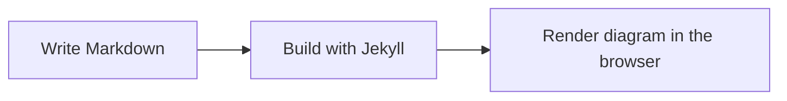
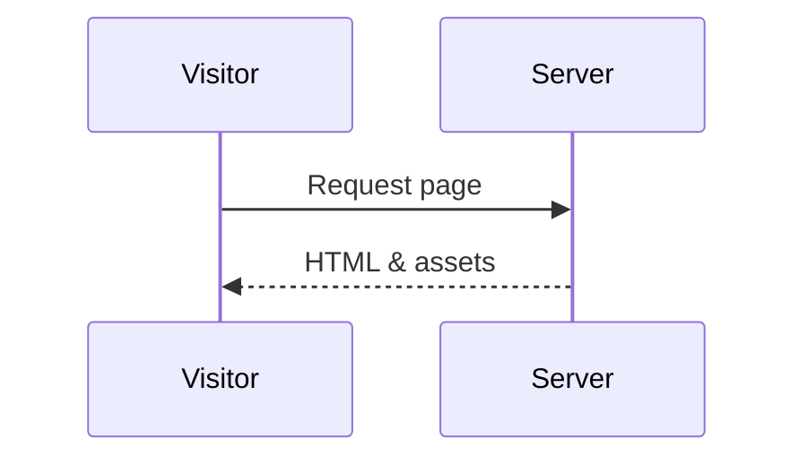

Mermaid code fences render automatically without a front matter setting.

## Flowchart



## Sequence diagram



## Regular code

This JavaScript block should remain a code block:

```javascript
const message = "Mermaid diagrams render alongside regular code blocks.";
```
